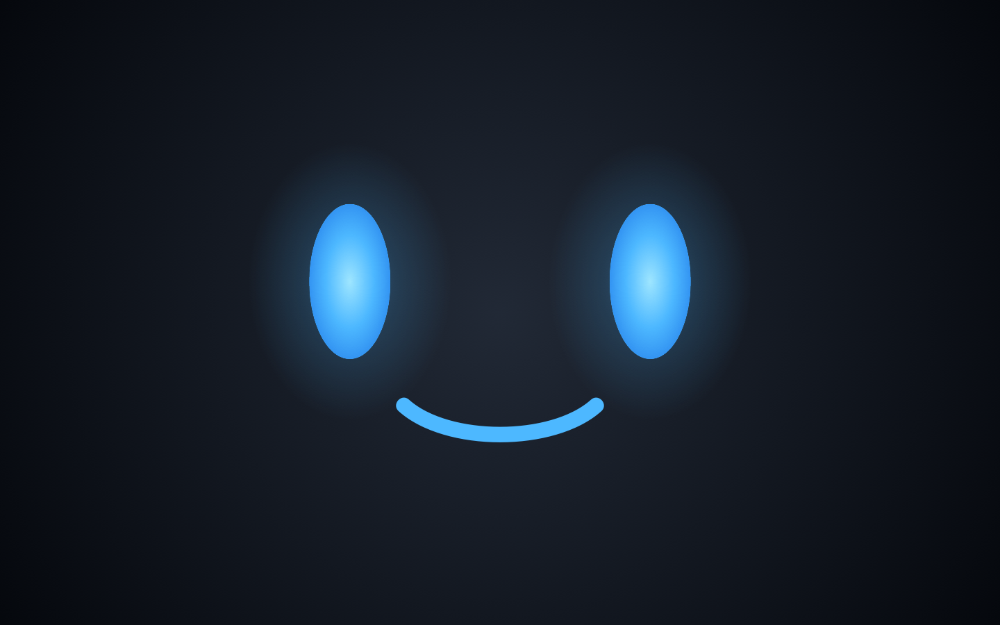
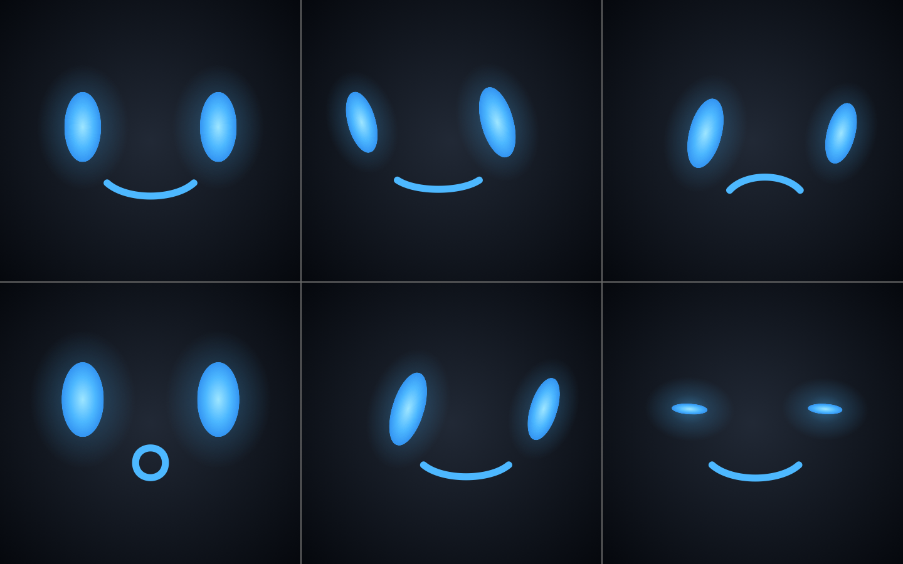
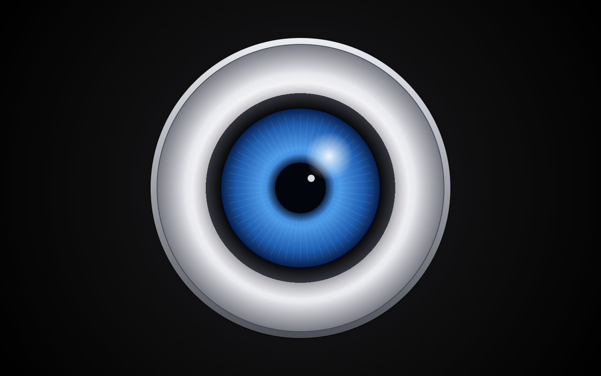
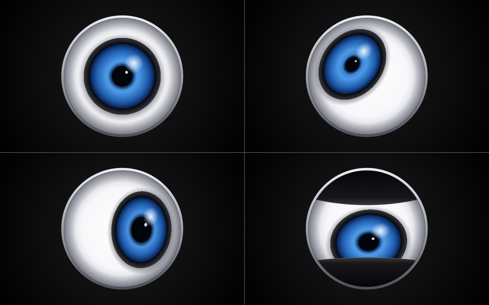

# RobotEye

A full-screen animated robot face for **Mac OS X 10.4.11 on PowerPC**, written in
Objective-C (Cocoa) and C (CoreGraphics). When it starts it takes over the whole
screen. It hides the menu bar, Dock and cursor, and shows a robot that looks
around on its own. **Press any key to quit.**

There are two versions, each marked with a git tag.

## Versions

### `v2-cartoon-face`: cute cartoon face (latest)

Two glowing blue oval eyes and a blue mouth on a dark background.

- The eyes look straight ahead or in random directions. They hold each gaze for
  a random time, then dart to the next one. Now and then they do a slow scan.
- When they look somewhere, the ovals lean toward that direction. They get
  narrower or shorter as if turning, and the near eye is a little smaller than
  the far one.
- They blink by squashing down to thin bars, sometimes twice in a row.
- The mouth mostly smiles, with an occasional frown or a surprised "O". In the
  "O" the eyes grow and dart somewhere new. The mouth morphs smoothly between
  the three shapes.

*Smiling, glancing left, frowning while looking down-right, surprised "O",
looking full right (leaning), mid-blink.*

### `v1-single-eye`: single robot eye

One large glossy cartoon eye: a silver rim, a white eyeball and a black-rimmed
blue iris with a pupil and highlights. The iris moves around inside the white.
It holds each gaze for a random time, darts or scans to the next, and the pupil
widens and narrows. Black eyelids blink now and then.

*Straight ahead, up-left with a small pupil, right with a wide pupil, mid-blink
looking down.*

To build this version instead of the latest:

    git checkout v1-single-eye
    make clean && make
    git checkout main         # back to the latest

## Project instructions

The project was built to these instructions, in order:

1. **Original brief.** Write an application for Mac OS X 10.4.11 on PowerPC,
   buildable with Xcode 2.5 or its command-line tools, in C or Objective-C.
   When it starts it takes over the entire screen and shows one robot eye. The
   eye looks straight ahead or in different directions for random intervals,
   then changes where it is looking. A keystroke ends the application. Set up
   git, and make an image file of how the eye will look so it can be critiqued.
2. Make the eye more cartoony and abstract. Keep the dark background, with
   more of just white outlines.
3. Make the eye look like the eye of the robot in a reference drawing
   (`robot1.jpg`): silver rim, white eyeball, blue iris. *(Tagged
   `v1-single-eye`.)*
4. Change direction to something cuter, using the face of a second reference
   drawing (`robot2.webp`) as a template. Two eyes that are just blue ovals,
   and a mouth that goes between smiling, an occasional frown, and an "O" of
   surprise.
5. Drop the helmeted head and navy visor: just the eyes and mouth.
6. Make the ovals lean into the direction they are looking. *(Tagged
   `v2-cartoon-face`.)*
7. Write up these instructions and build steps in this README. Tag the single
   eye and the cartoon face versions, with images of both.

The reference drawings are stock images and are not in the repository; see
`.gitignore`.

## Building

### Requirements

- Mac OS X 10.4.11 on PowerPC (G3/G4/G5).
- Xcode 2.5 Developer Tools (it supplies `gcc` 4.0 and `make`).

The app uses only Mac OS X 10.4 APIs and Objective-C 1.0 (no properties, no
fast enumeration, no `NSGradient`/`CGGradient`). It has no nib file: the
window and view are created in code.

### Build and run

From the project folder in Terminal:

    make          # builds RobotEye.app
    make run      # builds and launches it
    make clean    # removes build/ and RobotEye.app

You can also double-click `RobotEye.app` in the Finder. Press any key to quit.

The default build is for the machine's own architecture (PowerPC). To build a
Universal binary with the 10.4u SDK:

    make ARCHFLAGS="-arch ppc -arch i386 -isysroot /Developer/SDKs/MacOSX10.4u.sdk"

### Preview images

    make preview

This renders `docs/cartoon-face.png` and `docs/cartoon-face-poses.png` from
the real drawing code (`eye_draw.c`), without running the app. It works on
10.4 or any later Mac OS X.

## Files

| File | Purpose |
|------|---------|
| `main.m` | App startup, borderless full-screen window, hides the menu bar, Dock and cursor |
| `EyeView.m/.h` | Animation: random gaze targets, hold times, darts and scans, blinks, mouth expressions; quits on any key |
| `eye_draw.c/.h` | All drawing, in plain CoreGraphics (10.4-safe, gradients via `CGShading`) |
| `tools/preview.c` | Renders still PNGs with `eye_draw.c` |
| `Info.plist` | Application bundle settings |
| `Makefile` | Builds the `.app` bundle and the preview images |

## Tuning (cartoon face)

- **Timing and behaviour:** the `#define`s at the top of `EyeView.m`: hold
  times, blink gaps, chance of looking straight ahead, chance of a slow scan.
- **Moods:** `FROWN_CHANCE` and `SURPRISE_CHANCE` in `EyeView.m`.
- **Size and placement:** `FACE_*`, `EYE_*`, `GAZE_*` and `MOUTH_Y` at the top
  of `eye_draw.c`.
- **Lean with the gaze:** `EYE_LEAN` (maximum tilt in radians), `EYE_TURN_X`,
  `EYE_TURN_Y` and `EYE_DEPTH` in `eye_draw.c`.
- **Colours:** `GLOW_*` (eyes and mouth) and `kBackgroundRamp` in `eye_draw.c`.
