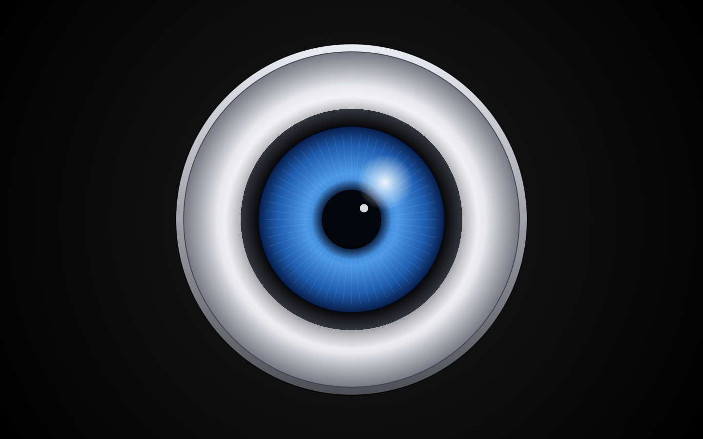

# RobotEye

A full-screen robot eye for Mac OS X 10.4.11 on PowerPC. When it launches it
takes over the screen. It hides the menu bar, Dock and cursor and shows one
glossy cartoon robot eye: silver rim, white eyeball, and a black-rimmed
blue iris that moves around inside it. The eye holds a gaze for a random time, then darts to a new
direction or back to straight ahead. Now and then it does a slow scan, and it
blinks with black eyelids. **Press any key to quit.**

## Building (Xcode 2.5 command-line tools)

    make          # builds RobotEye.app
    make run      # builds and launches it
    make preview  # re-renders the preview PNGs from the real drawing code
    make clean

You can also double-click `RobotEye.app` in the Finder.

## Files

| File | Purpose |
|------|---------|
| `main.m` | App startup, borderless full-screen window, hides the menu bar, Dock and cursor |
| `EyeView.m/.h` | Animation: random gaze targets, hold times, saccades and scans, pupil, blinks; quits on any key |
| `eye_draw.c/.h` | All drawing, in plain CoreGraphics (10.4-safe, gradients via CGShading) |
| `tools/preview.c` | Renders still PNGs with `eye_draw.c` |

## Tuning

- Timing and behavior: the `#define`s at the top of `EyeView.m`.
- Size and proportions: the `*_FRAC` values at the top of `eye_draw.c`.
- Colors: the `Ramp` tables in `eye_draw.c`. `kIrisRamp` sets the iris color.
